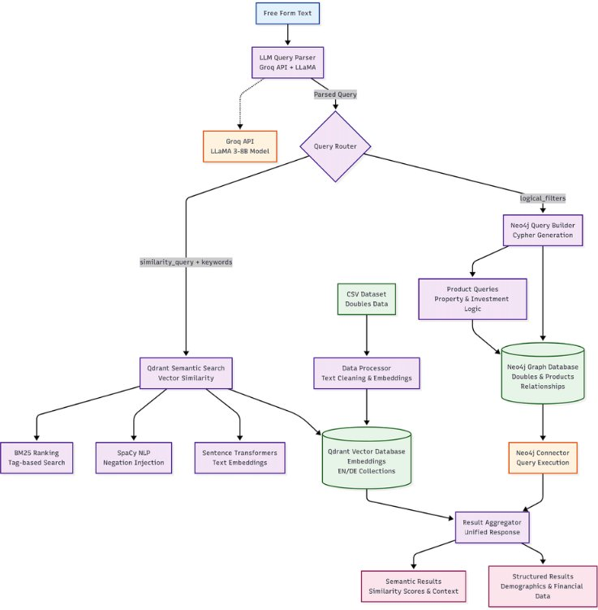
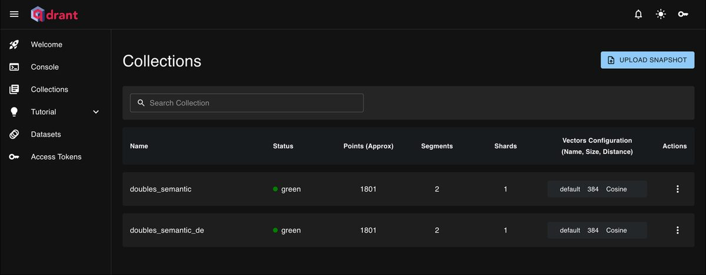

# RAG System for Double Matching

A Retrieval-Augmented Generation (RAG) system that combines semantic search and structured queries to find and match doubles based on various criteria. The system integrates Neo4j for graph database operations and Qdrant for vector similarity search.


## 🏗️ System Architecture



**Query flow:**
1. **Free-form text** → LLaMA (via Groq API) parses into structured JSON with logical filters + semantic search text
2. **Query Router** splits into two parallel paths:
   - **Neo4j path**: Cypher queries for structured/demographic filters (age, income, property, investments)
   - **Qdrant path**: Vector similarity search with BM25 ranking, spaCy NLP, and Sentence Transformers embeddings
3. **Result Aggregator** merges structured + semantic results into a unified response

**Key design decisions:**
- Bilingual (EN/DE) with separate Qdrant collections and automatic language detection
- Doubles linked to Products (Property, Investment, BankAccount, Pension) in Neo4j graph
- Negation handling via spaCy NLP injection for accurate semantic matching


## 🌟 Features

- **Doubles Management**
  - Store and manage doubles with profile attributes in Neo4j
  - Link doubles with various product nodes (Property, Insurance, BankAccount, etc.)
  - Support for complex product-based filtering and value range queries

- **AI-Powered Search**
  - Natural language query parsing using LLaMA model (via Groq API)
  - Conversion of free-form text to structured JSON queries
  - Semantic search capabilities using SentenceTransformers and Qdrant

- **Hybrid Search System**
  - Structured queries through Neo4j Cypher
  - Vector similarity search via Qdrant
  - Parallel execution of semantic and structured searches

## 🚀 Getting Started

### Prerequisites

- Python 3.8+
- Neo4j Database
- Qdrant Vector Database
- Groq API access

### Installation

1. Clone the repository:
```bash
git clone [repository-url]
cd RAG_System
```

2. Create and activate a virtual environment:
```bash
python -m venv venv
source venv/bin/activate  # On Windows: venv\Scripts\activate
```

3. Install dependencies:
```bash
pip install -r requirements.txt
```

4. Set up environment variables:
```bash
# Create a .env file with:
NEO4J_URI=your_neo4j_uri
NEO4J_USER=your_neo4j_user
NEO4J_PASSWORD=your_neo4j_password
GROQ_API_KEY=your_groq_api_key
QDRANT_URL=your_qdrant_url
QDRANT_API_KEY=your_qdrant_api_key
```

## 🏗️ Project Structure

- `app.py` - Main application file with Streamlit UI
- `neo4j_connector.py` - Neo4j database connection handler
- `neo4j_product_queries.py` - Product-related Neo4j queries
- `neo4j_query_builder.py` - Cypher query builder
- `qdrantnew.py` - Qdrant vector database integration
- `query_parser_llama_groq.py` - Natural language query parser using LLaMA

## 💻 Usage

1. Start the application:
```bash
streamlit run app.py
```

2. Access the web interface at `http://localhost:8501`

3. Enter your search query in natural language or use structured filters

### Example Queries

```python
# Natural Language Query
"Find doubles who own property worth more than 200,000 and have savings accounts"

# Structured Query
{
    "products": {
        "Property": {"min": 200000},
        "BankAccount": {"exists": true}
    }
}
```

## 🔄 Data Flow

1. User inputs query (natural language or structured)
2. If natural language:
   - Query is parsed by LLaMA model into structured format
3. System executes:
   - Structured search in Neo4j
   - Semantic search in Qdrant
4. Results are combined and presented to user

## 🛠️ Current Status

The system is currently in a proof-of-concept stage with:
- Core infrastructure (Neo4j + Qdrant) operational
- Basic query processing pipeline implemented
- Parallel execution of semantic and structured searches
- Active development and experimentation ongoing


## 📸 Screenshots

### Main Interface
The Unified Doubles Search Assistant — free-form query input with example queries, debug mode, and bilingual support.


### System Architecture


### Neo4j Knowledge Graph
Doubles linked to their products — the graph structure enables relationship-aware retrieval.


### Natural Language → Structured Query
LLaMA parses free-form text into keywords, logical filters, and a semantic search query.


### Semantic Search Results
Qdrant returns ranked matches with relevance scores.


### Vector Database (Qdrant)
Bilingual collections — 1,801 doubles each in English and German.


### Structured Queries (Neo4j)
Cypher queries for precise demographic and product filtering.


## 👥 Contributor

- Muhammad Murad Siddiqui

## 🤝 Contributing

Contributions are welcome! Please feel free to submit a Pull Request. 
